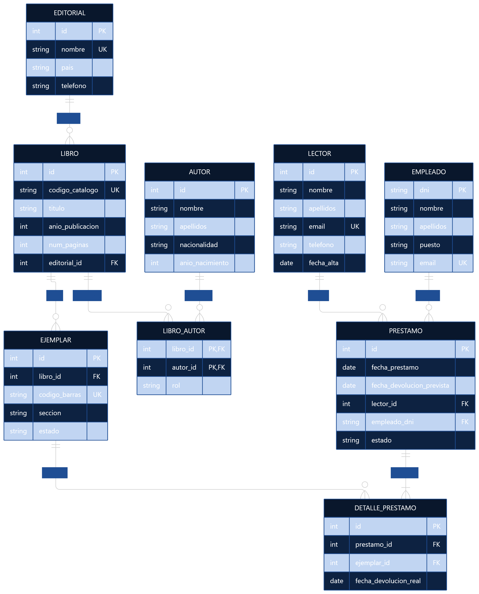

# Fase 3. Diseño y documentación de la base de datos de la Biblioteca de Aragón


| | |
|---|---|
| **Fase** | 3. Diseño y documentación de la base de datos |
| **Alumnos** | Alejandro e Izan |

---

## Índice

- [Parte 1. El encargo: caso de estudio](#parte-1-el-encargo-caso-de-estudio)
- [Apartado 1. Resumen del caso](#apartado-1-resumen-del-caso)
- [Apartado 2. Análisis del caso](#apartado-2-análisis-del-caso)
- [Apartado 3. Reglas de negocio](#apartado-3-reglas-de-negocio)
- [Apartado 4. Diagrama entidad-relación](#apartado-4-diagrama-entidad-relación)
- [Apartado 5. Modelo lógico](#apartado-5-modelo-lógico)
- [Apartado 6. Script SQL ejecutable](#apartado-6-script-sql-ejecutable)
- [Apartado 7. Diccionario de datos](#apartado-7-diccionario-de-datos)
- [Apartado 8. Decisiones de diseño](#apartado-8-decisiones-de-diseño)
- [Apartado 9. Datos de prueba](#apartado-9-datos-de-prueba)
- [Apartado 10. Consultas de prueba](#apartado-10-consultas-de-prueba)
- [Apartado 11. Limitaciones y mejoras futuras](#apartado-11-limitaciones-y-mejoras-futuras)

---

# Parte 1. El encargo: caso de estudio

> La biblioteca necesita organizar su catálogo, controlar los ejemplares físicos y registrar los préstamos. El objetivo del caso es identificar qué información debe guardarse y cómo se relaciona.

## 1. La biblioteca

La **Biblioteca de Aragón, en Zaragoza**, sirve como contexto institucional para este caso académico. Para el ejercicio se plantea un sistema ficticio que centraliza los datos bibliográficos, los ejemplares disponibles y los préstamos a lectores.

La gestión necesita conocer qué libros forman parte del catálogo, cuántos ejemplares existen de cada título, dónde están ubicados y cuáles se encuentran prestados, disponibles o en reparación.

## 2. Los libros y las editoriales

La biblioteca dispone de un catálogo de libros. De cada libro se guarda un identificador interno, el código de catálogo, el título, el año de publicación, el número de páginas y la editorial que publicó la edición.

Cada libro se asocia a una sola editorial. Una editorial puede publicar muchos libros.

### Ejemplo de libros

| **ID** | **Código** | **Título** | **Año** | **Páginas** | **Editorial** |
|---:|---|---|---:|---:|---|
| 1 | LIB001 | Cien años de soledad | 1967 | 496 | Penguin Random House |
| 2 | LIB002 | Don Quijote de la Mancha | 1605 | 1056 | Cátedra |
| 3 | LIB003 | La sombra del viento | 2001 | 576 | Planeta |
| 4 | LIB004 | El principito | 1943 | 96 | Salamandra |
| 5 | LIB005 | 1984 | 1949 | 328 | Alianza Editorial |
| 6 | LIB006 | Antología del cuento hispanoamericano | 2020 | 420 | Alianza Editorial |

### Ejemplo de editoriales

| **ID** | **Nombre** | **País** | **Teléfono** |
|---:|---|---|---|
| 1 | Cátedra | España | 910000101 |
| 2 | Penguin Random House | España | 910000102 |
| 3 | Planeta | España | 930000103 |
| 4 | Salamandra | España | 930000104 |
| 5 | Alianza Editorial | España | 910000105 |

Los nombres se emplean como datos de prueba; las filas no pretenden describir las existencias reales de la biblioteca.

## 3. Los autores

Un libro puede tener uno o varios autores y un autor puede participar en diferentes libros. Por eso, la relación entre libros y autores puede ser de muchos a muchos.

De cada autor se guarda un identificador, su nombre, apellidos, nacionalidad y año de nacimiento. Además, se quiere distinguir si participa como autor principal o colaborador en cada libro.

### Ejemplo de autores

| **ID** | **Nombre** | **Apellidos** | **Nacionalidad** | **Año de nacimiento** |
|---:|---|---|---|---:|
| 1 | Gabriel | García Márquez | Colombiana | 1927 |
| 2 | Miguel de | Cervantes Saavedra | Española | 1547 |
| 3 | Carlos Ruiz | Zafón | Española | 1964 |
| 4 | Antoine | de Saint-Exupéry | Francesa | 1900 |
| 5 | George | Orwell | Británica | 1903 |
| 6 | Julio | Cortázar | Argentina | 1914 |
| 7 | Jorge Luis | Borges | Argentina | 1899 |

La relación libro-autor guardará también el papel del autor en esa obra.

## 4. Los ejemplares y el inventario

La biblioteca no presta únicamente títulos abstractos: presta ejemplares físicos concretos. Cada ejemplar tiene un código de barras propio y está asociado a un libro del catálogo.

De cada ejemplar se guarda:

- Un identificador.
- El libro al que corresponde.
- El código de barras.
- La sección o ubicación.
- El estado actual.

Los estados utilizados en este modelo son `DISPONIBLE`, `PRESTADO`, `REPARACION` y `PERDIDO`.

### Ejemplo de ejemplares

| **ID** | **Código de barras** | **Libro** | **Sección** | **Estado** |
|---:|---|---|---|---|
| 1 | BIB-0001 | Don Quijote de la Mancha | Adultos | PRESTADO |
| 2 | BIB-0002 | Don Quijote de la Mancha | Adultos | DISPONIBLE |
| 3 | BIB-0003 | Cien años de soledad | Adultos | PRESTADO |
| 4 | BIB-0004 | Cien años de soledad | Adultos | DISPONIBLE |
| 5 | BIB-0005 | La sombra del viento | Novela | PRESTADO |
| 6 | BIB-0006 | La sombra del viento | Novela | DISPONIBLE |
| 7 | BIB-0007 | El principito | Infantil | PRESTADO |
| 8 | BIB-0008 | El principito | Infantil | DISPONIBLE |

Un libro puede tener varios ejemplares. El número de ejemplares disponibles se obtiene contando los ejemplares cuyo estado sea `DISPONIBLE`.

## 5. Los lectores

Los lectores registrados pueden llevarse ejemplares en préstamo. De cada lector se guarda un identificador, nombre, apellidos, correo electrónico, teléfono y fecha de alta.

### Ejemplo de lectores

| **ID** | **Nombre** | **Apellidos** | **Correo** | **Teléfono** | **Fecha de alta** |
|---:|---|---|---|---|---|
| 1 | Elena | Ruiz | elena.ruiz@example.com | 600111222 | 2025-09-01 |
| 2 | Andrés | Pérez | andres.perez@example.com | 600333444 | 2025-10-15 |
| 3 | Marta | López | marta.lopez@example.com | 600555666 | 2026-01-12 |
| 4 | Laura | Gómez | laura.gomez@example.com | 600777888 | 2026-03-20 |

## 6. El personal

El personal registra las operaciones de préstamo y ayuda a mantener la información actualizada.

De cada empleado se guarda el DNI, nombre, apellidos, puesto y correo electrónico.

### Ejemplo de empleados

| **DNI** | **Nombre** | **Apellidos** | **Puesto** | **Correo** |
|---|---|---|---|---|
| 12345678A | Ana | Martín López | Bibliotecaria | ana.martin@example.com |
| 87654321B | Carlos | Pérez Sanz | Auxiliar | carlos.perez@example.com |
| 11223344C | Elena | Sanz Ruiz | Bibliotecaria | elena.sanz@example.com |

Un empleado puede registrar muchos préstamos y cada préstamo queda asociado a un único empleado.

## 7. Los préstamos

Cada operación de préstamo registra cuándo sale el material, cuándo está previsto devolverlo, qué lector se lo lleva y qué empleado registra la operación.

De cada préstamo se guarda:

- Un identificador.
- La fecha del préstamo.
- La fecha prevista de devolución.
- El lector.
- El empleado responsable del registro.
- El estado del préstamo.

Los estados del modelo son `ACTIVO`, `DEVUELTO` y `CANCELADO`. La duración de los préstamos que aparece en los ejemplos es ficticia y no representa una condición oficial de la biblioteca.

### Ejemplo de préstamos

| **Préstamo** | **Fecha** | **Devolución prevista** | **Lector** | **Empleado** | **Estado** |
|---:|---|---|---|---|---|
| 1001 | 2026-10-01 | 2026-10-29 | Elena Ruiz | Ana Martín López | ACTIVO |
| 1002 | 2026-08-20 | 2026-09-17 | Andrés Pérez | Carlos Pérez Sanz | ACTIVO |
| 1003 | 2026-09-01 | 2026-09-29 | Elena Ruiz | Ana Martín López | DEVUELTO |
| 1004 | 2026-10-08 | 2026-11-05 | Marta López | Elena Sanz Ruiz | ACTIVO |
| 1005 | 2026-10-10 | 2026-11-07 | Laura Gómez | Ana Martín López | ACTIVO |
| 1006 | 2026-10-09 | 2026-11-06 | Elena Ruiz | Carlos Pérez Sanz | ACTIVO |

Un préstamo puede contener varios ejemplares, por lo que se necesita un detalle de préstamo.

## 8. El detalle de préstamo

Cada línea del detalle relaciona un préstamo con un ejemplar concreto. También permite guardar la fecha en la que se devolvió realmente ese ejemplar.

### Ejemplo de detalle

| **ID** | **Préstamo** | **Ejemplar** | **Fecha de devolución real** |
|---:|---:|---|---|
| 1 | 1001 | BIB-0001 | — |
| 2 | 1002 | BIB-0003 | — |
| 3 | 1003 | BIB-0013 | 2026-09-20 |
| 4 | 1004 | BIB-0005 | — |
| 5 | 1005 | BIB-0007 | — |
| 6 | 1006 | BIB-0011 | — |

Una línea sin fecha de devolución real representa un ejemplar que todavía no se ha registrado como devuelto. El estado del ejemplar debe mantenerse coherente con sus préstamos activos.

## 9. Lo que la biblioteca quiere poder consultar

La base de datos debe ayudar a responder preguntas como estas:

- ¿Qué libros forman parte del catálogo y quién los publicó?
- ¿Qué autores participan en cada libro?
- ¿Cuántos ejemplares hay de cada título y cuántos están disponibles?
- ¿Qué préstamos siguen activos?
- ¿Qué préstamos han superado la fecha prevista de devolución?
- ¿Qué lector tiene más préstamos registrados?
- ¿Qué libros se han prestado más veces?
- ¿Qué empleado ha registrado más préstamos?
- ¿Qué ejemplares corresponden a un préstamo determinado?

## 10. Resumen del encargo

El objetivo es diseñar una base de datos que permita gestionar el catálogo bibliográfico, las editoriales, los autores, los ejemplares físicos, los lectores, los empleados y los préstamos.

La solución deberá identificar las entidades, definir sus relaciones, documentar las claves, crear el script SQL, insertar datos de prueba y comprobar el funcionamiento con consultas.

---

# Apartado 1. Resumen del caso

La Biblioteca de Aragón, en Zaragoza, sirve como contexto para un caso académico de gestión bibliotecaria. El sistema propuesto centraliza la información de libros, autores, editoriales, ejemplares, lectores, empleados y préstamos.

El catálogo describe cada obra y su editorial; la relación entre libros y autores permite registrar obras con varios autores; la tabla de ejemplares identifica cada copia física. Los préstamos relacionan a los lectores y empleados con los ejemplares que salen de la biblioteca.

---

# Apartado 2. Análisis del caso

## 2.1. Entidades y atributos

| Entidad | Atributos principales | Referencia |
|---|---|---|
| `editorial` | id, nombre, pais, telefono | §2 |
| `libro` | id, codigo_catalogo, titulo, anio_publicacion, num_paginas, editorial_id | §2 |
| `autor` | id, nombre, apellidos, nacionalidad, anio_nacimiento | §3 |
| `libro_autor` | libro_id, autor_id, rol | §3 |
| `ejemplar` | id, libro_id, codigo_barras, seccion, estado | §4 |
| `lector` | id, nombre, apellidos, email, telefono, fecha_alta | §5 |
| `empleado` | dni, nombre, apellidos, puesto, email | §6 |
| `prestamo` | id, fecha_prestamo, fecha_devolucion_prevista, lector_id, empleado_dni, estado | §7 |
| `detalle_prestamo` | id, prestamo_id, ejemplar_id, fecha_devolucion_real | §8 |

## 2.2. Relaciones

| Relación | Cardinalidad | Razonamiento |
|---|---|---|
| `editorial` - `libro` | 1:N | Una editorial puede publicar muchos libros; cada libro de este modelo tiene una editorial. |
| `libro` - `autor` | N:M | Un libro puede tener varios autores y un autor puede participar en muchos libros. Se resuelve mediante `libro_autor`. |
| `libro` - `ejemplar` | 1:N | Un título puede tener varias copias físicas; cada ejemplar corresponde a un libro. |
| `lector` - `prestamo` | 1:N | Un lector puede tener muchos préstamos; cada préstamo corresponde a un lector. |
| `empleado` - `prestamo` | 1:N | Un empleado puede registrar muchos préstamos; cada préstamo se registra por un empleado. |
| `prestamo` - `detalle_prestamo` | 1:N | Un préstamo puede incluir varios ejemplares. |
| `ejemplar` - `detalle_prestamo` | 1:N a lo largo del tiempo | Un ejemplar puede aparecer en distintos préstamos históricos, pero no debe tener dos préstamos activos a la vez. |

---

# Apartado 3. Reglas de negocio

1. Cada libro tiene un identificador interno único y un código de catálogo no repetido.
2. Cada libro está asociado a una editorial en este modelo.
3. Una editorial puede estar asociada a muchos libros.
4. Un libro puede tener varios autores y un autor puede participar en varios libros.
5. La tabla `libro_autor` registra el papel de cada autor en la obra.
6. Cada ejemplar físico tiene un código de barras único.
7. Cada ejemplar corresponde a un único libro.
8. El estado de un ejemplar debe ser `DISPONIBLE`, `PRESTADO`, `REPARACION` o `PERDIDO`.
9. Cada lector tiene un identificador y un correo electrónico único.
10. Cada préstamo corresponde a un único lector y a un único empleado.
11. Un préstamo puede incluir uno o varios ejemplares mediante `detalle_prestamo`.
12. Un ejemplar puede aparecer en varios préstamos a lo largo del tiempo, pero no puede tener dos préstamos activos simultáneamente.
13. La fecha prevista de devolución no puede ser anterior a la fecha del préstamo.
14. La fecha real de devolución puede quedar vacía mientras el ejemplar siga prestado.
15. Cuando se devuelve un ejemplar, debe actualizarse su estado a `DISPONIBLE`, salvo que necesite reparación u otro tratamiento.
16. El préstamo se considera `DEVUELTO` cuando todos sus ejemplares han sido devueltos.
17. El catálogo y los datos de ejemplo son ficticios; las condiciones reales de préstamo deberán consultarse con la institución antes de desarrollar un sistema real.

---

# Apartado 4. Diagrama entidad-relación

El diagrama debe representar las nueve tablas del modelo, sus atributos, claves primarias, claves foráneas y cardinalidades.

## 4.1. Diagrama



## 4.2. Tabla de relaciones

| Relación | Tipo | Cómo se resuelve |
|---|---|---|
| `editorial` - `libro` | 1:N | `libro.editorial_id` |
| `libro` - `autor` | N:M | Tabla intermedia `libro_autor` |
| `libro` - `ejemplar` | 1:N | `ejemplar.libro_id` |
| `lector` - `prestamo` | 1:N | `prestamo.lector_id` |
| `empleado` - `prestamo` | 1:N | `prestamo.empleado_dni` |
| `prestamo` - `detalle_prestamo` | 1:N | `detalle_prestamo.prestamo_id` |
| `ejemplar` - `detalle_prestamo` | 1:N histórico | `detalle_prestamo.ejemplar_id` |

---

# Apartado 5. Modelo lógico

## 5.1. Tabla `editorial`

| Columna | Clave | Referencia |
|---|---|---|
| `id` | PK | |
| `nombre` | UNIQUE | |
| `pais` | | |
| `telefono` | | |

## 5.2. Tabla `autor`

| Columna | Clave | Referencia |
|---|---|---|
| `id` | PK | |
| `nombre` | | |
| `apellidos` | | |
| `nacionalidad` | | |
| `anio_nacimiento` | | |

## 5.3. Tabla `libro`

| Columna | Clave | Referencia |
|---|---|---|
| `id` | PK | |
| `codigo_catalogo` | UNIQUE | |
| `titulo` | | |
| `anio_publicacion` | | |
| `num_paginas` | | |
| `editorial_id` | FK | `editorial.id` |

## 5.4. Tabla `libro_autor`

| Columna | Clave | Referencia |
|---|---|---|
| `libro_id` | PK, FK | `libro.id` |
| `autor_id` | PK, FK | `autor.id` |
| `rol` | | |

La clave primaria está formada por la combinación de `libro_id` y `autor_id`.

## 5.5. Tabla `ejemplar`

| Columna | Clave | Referencia |
|---|---|---|
| `id` | PK | |
| `libro_id` | FK | `libro.id` |
| `codigo_barras` | UNIQUE | |
| `seccion` | | |
| `estado` | | |

## 5.6. Tabla `lector`

| Columna | Clave | Referencia |
|---|---|---|
| `id` | PK | |
| `nombre` | | |
| `apellidos` | | |
| `email` | UNIQUE | |
| `telefono` | | |
| `fecha_alta` | | |

## 5.7. Tabla `empleado`

| Columna | Clave | Referencia |
|---|---|---|
| `dni` | PK | |
| `nombre` | | |
| `apellidos` | | |
| `puesto` | | |
| `email` | UNIQUE | |

## 5.8. Tabla `prestamo`

| Columna | Clave | Referencia |
|---|---|---|
| `id` | PK | |
| `fecha_prestamo` | | |
| `fecha_devolucion_prevista` | | |
| `lector_id` | FK | `lector.id` |
| `empleado_dni` | FK | `empleado.dni` |
| `estado` | | |

## 5.9. Tabla `detalle_prestamo`

| Columna | Clave | Referencia |
|---|---|---|
| `id` | PK | |
| `prestamo_id` | FK | `prestamo.id` |
| `ejemplar_id` | FK | `ejemplar.id` |
| `fecha_devolucion_real` | | |

---

# Apartado 6. Script SQL ejecutable

El siguiente script crea la base de datos y sus nueve tablas. Está pensado para MySQL 8.0 o posterior.

```sql
CREATE DATABASE IF NOT EXISTS biblioteca_aragon
    CHARACTER SET utf8mb4
    COLLATE utf8mb4_unicode_ci;

CREATE TABLE editorial (
    id INT PRIMARY KEY AUTO_INCREMENT,
    nombre VARCHAR(120) NOT NULL UNIQUE,
    pais VARCHAR(80) NOT NULL,
    telefono VARCHAR(25)
);

CREATE TABLE autor (
    id INT PRIMARY KEY AUTO_INCREMENT,
    nombre VARCHAR(60) NOT NULL,
    apellidos VARCHAR(100) NOT NULL,
    nacionalidad VARCHAR(60),
    anio_nacimiento SMALLINT
);

CREATE TABLE lector (
    id INT PRIMARY KEY AUTO_INCREMENT,
    nombre VARCHAR(60) NOT NULL,
    apellidos VARCHAR(100) NOT NULL,
    email VARCHAR(150) NOT NULL UNIQUE,
    telefono VARCHAR(20),
    fecha_alta DATE NOT NULL
);

CREATE TABLE empleado (
    dni VARCHAR(12) PRIMARY KEY,
    nombre VARCHAR(60) NOT NULL,
    apellidos VARCHAR(100) NOT NULL,
    puesto VARCHAR(60) NOT NULL,
    email VARCHAR(150) NOT NULL UNIQUE
);

CREATE TABLE libro (
    id INT PRIMARY KEY AUTO_INCREMENT,
    codigo_catalogo VARCHAR(20) NOT NULL UNIQUE,
    titulo VARCHAR(180) NOT NULL,
    anio_publicacion SMALLINT,
    num_paginas INT,
    editorial_id INT NOT NULL,
    CONSTRAINT fk_libro_editorial
        FOREIGN KEY (editorial_id) REFERENCES editorial(id),
    CHECK (num_paginas IS NULL OR num_paginas > 0)
);

CREATE TABLE libro_autor (
    libro_id INT NOT NULL,
    autor_id INT NOT NULL,
    rol ENUM('PRINCIPAL', 'COLABORADOR') NOT NULL DEFAULT 'PRINCIPAL',
    PRIMARY KEY (libro_id, autor_id),
    FOREIGN KEY (libro_id) REFERENCES libro(id),
    FOREIGN KEY (autor_id) REFERENCES autor(id)
);

CREATE TABLE ejemplar (
    id INT PRIMARY KEY AUTO_INCREMENT,
    libro_id INT NOT NULL,
    codigo_barras VARCHAR(30) NOT NULL UNIQUE,
    seccion VARCHAR(60) NOT NULL,
    estado ENUM('DISPONIBLE', 'PRESTADO', 'REPARACION', 'PERDIDO') NOT NULL DEFAULT 'DISPONIBLE',
    FOREIGN KEY (libro_id) REFERENCES libro(id)
);

CREATE TABLE prestamo (
    id INT PRIMARY KEY,
    fecha_prestamo DATE NOT NULL,
    fecha_devolucion_prevista DATE NOT NULL,
    lector_id INT NOT NULL,
    empleado_dni VARCHAR(12) NOT NULL,
    estado ENUM('ACTIVO', 'DEVUELTO', 'CANCELADO') NOT NULL DEFAULT 'ACTIVO',
    FOREIGN KEY (lector_id) REFERENCES lector(id),
    FOREIGN KEY (empleado_dni) REFERENCES empleado(dni),
    CHECK (fecha_devolucion_prevista >= fecha_prestamo)
);

CREATE TABLE detalle_prestamo (
    id INT PRIMARY KEY AUTO_INCREMENT,
    prestamo_id INT NOT NULL,
    ejemplar_id INT NOT NULL,
    fecha_devolucion_real DATE NULL,
    FOREIGN KEY (prestamo_id) REFERENCES prestamo(id),
    FOREIGN KEY (ejemplar_id) REFERENCES ejemplar(id),
    UNIQUE (prestamo_id, ejemplar_id)
);
```

---

# Apartado 7. Diccionario de datos

## 7.1. Tabla `editorial`

| Columna | Tipo | Obligatorio | Descripción |
|---|---|:---:|---|
| `id` | INT | Sí | Identificador de la editorial. |
| `nombre` | VARCHAR(120) | Sí | Nombre de la editorial; no se repite. |
| `pais` | VARCHAR(80) | Sí | País de la editorial. |
| `telefono` | VARCHAR(25) | No | Teléfono de contacto. |

## 7.2. Tabla `autor`

| Columna | Tipo | Obligatorio | Descripción |
|---|---|:---:|---|
| `id` | INT | Sí | Identificador del autor. |
| `nombre` | VARCHAR(60) | Sí | Nombre del autor. |
| `apellidos` | VARCHAR(100) | Sí | Apellidos del autor. |
| `nacionalidad` | VARCHAR(60) | No | Nacionalidad del autor. |
| `anio_nacimiento` | SMALLINT | No | Año de nacimiento, si se conoce. |

## 7.3. Tabla `libro`

| Columna | Tipo | Obligatorio | Descripción |
|---|---|:---:|---|
| `id` | INT | Sí | Identificador interno del libro. |
| `codigo_catalogo` | VARCHAR(20) | Sí | Código interno único utilizado para localizar la ficha bibliográfica. |
| `titulo` | VARCHAR(180) | Sí | Título de la obra. |
| `anio_publicacion` | SMALLINT | No | Año de publicación de la edición catalogada. |
| `num_paginas` | INT | No | Número de páginas de la edición. |
| `editorial_id` | INT | Sí | Editorial responsable de la edición; referencia a `editorial.id`. |

## 7.4. Tabla `libro_autor`

| Columna | Tipo | Obligatorio | Descripción |
|---|---|:---:|---|
| `libro_id` | INT | Sí | Libro relacionado; forma parte de la clave primaria. |
| `autor_id` | INT | Sí | Autor relacionado; forma parte de la clave primaria. |
| `rol` | ENUM | Sí | Indica si es autor principal o colaborador. |

## 7.5. Tabla `ejemplar`

| Columna | Tipo | Obligatorio | Descripción |
|---|---|:---:|---|
| `id` | INT | Sí | Identificador de la copia física. |
| `libro_id` | INT | Sí | Libro al que pertenece el ejemplar. |
| `codigo_barras` | VARCHAR(30) | Sí | Código único impreso o asociado al ejemplar. |
| `seccion` | VARCHAR(60) | Sí | Sección o ubicación, por ejemplo Adultos o Infantil. |
| `estado` | ENUM | Sí | Estado actual del ejemplar. |

## 7.6. Tabla `lector`

| Columna | Tipo | Obligatorio | Descripción |
|---|---|:---:|---|
| `id` | INT | Sí | Identificador del lector. |
| `nombre` | VARCHAR(60) | Sí | Nombre del lector. |
| `apellidos` | VARCHAR(100) | Sí | Apellidos del lector. |
| `email` | VARCHAR(150) | Sí | Correo único de contacto. |
| `telefono` | VARCHAR(20) | No | Teléfono de contacto. |
| `fecha_alta` | DATE | Sí | Fecha de registro. |

## 7.7. Tabla `empleado`

| Columna | Tipo | Obligatorio | Descripción |
|---|---|:---:|---|
| `dni` | VARCHAR(12) | Sí | Identificador del empleado. |
| `nombre` | VARCHAR(60) | Sí | Nombre del empleado. |
| `apellidos` | VARCHAR(100) | Sí | Apellidos del empleado. |
| `puesto` | VARCHAR(60) | Sí | Puesto de trabajo. |
| `email` | VARCHAR(150) | Sí | Correo electrónico único. |

## 7.8. Tabla `prestamo`

| Columna | Tipo | Obligatorio | Descripción |
|---|---|:---:|---|
| `id` | INT | Sí | Identificador del préstamo. |
| `fecha_prestamo` | DATE | Sí | Fecha en que se registra el préstamo. |
| `fecha_devolucion_prevista` | DATE | Sí | Fecha prevista para devolver los ejemplares. |
| `lector_id` | INT | Sí | Lector responsable del préstamo. |
| `empleado_dni` | VARCHAR(12) | Sí | Empleado que registra la operación. |
| `estado` | ENUM | Sí | Estado general del préstamo. |

## 7.9. Tabla `detalle_prestamo`

| Columna | Tipo | Obligatorio | Descripción |
|---|---|:---:|---|
| `id` | INT | Sí | Identificador de la línea de detalle. |
| `prestamo_id` | INT | Sí | Préstamo al que pertenece. |
| `ejemplar_id` | INT | Sí | Ejemplar físico prestado. |
| `fecha_devolucion_real` | DATE | No | Fecha en que se devolvió el ejemplar; queda vacía mientras esté prestado. |

---

# Apartado 8. Decisiones de diseño

## 8.1. Separar libro y ejemplar

**Decisión:** guardar el título en `libro` y cada copia física en `ejemplar`.

**Motivo:** una misma obra puede tener varias copias y cada una puede encontrarse en un estado diferente.

**Alternativa descartada:** guardar un campo `stock` en `libro`, porque no permitiría identificar qué copia concreta está prestada o disponible.

## 8.2. Separar autores y libros

**Decisión:** utilizar `autor` y una tabla intermedia `libro_autor`.

**Motivo:** un libro puede tener varios autores y una persona puede participar en diferentes libros. La tabla intermedia también almacena el papel del autor.

**Alternativa descartada:** guardar todos los nombres de los autores en una única columna de texto.

## 8.3. Separar préstamo y detalle de préstamo

**Decisión:** utilizar `prestamo` para la operación general y `detalle_prestamo` para cada ejemplar.

**Motivo:** un lector puede llevarse varios ejemplares en una misma operación y devolverlos en fechas diferentes.

**Alternativa descartada:** crear un préstamo distinto por cada ejemplar, perdiendo la agrupación de una misma operación.

## 8.4. Conservar el historial de devoluciones

**Decisión:** incluir `fecha_devolucion_real` en `detalle_prestamo`.

**Motivo:** permite conocer cuándo se devolvió cada ejemplar y consultar el historial de los préstamos.

**Alternativa descartada:** guardar solo el estado actual del ejemplar, sin conservar la fecha de devolución de operaciones anteriores.

## 8.5. Calcular las unidades disponibles

**Decisión:** obtener el número de copias disponibles contando los ejemplares con estado `DISPONIBLE`.

**Motivo:** evita duplicar el mismo dato en una columna de stock que podría quedarse desactualizada.

**Alternativa descartada:** guardar manualmente el número de copias disponibles dentro de `libro`.

## 8.6. Utilizar claves foráneas

**Decisión:** relacionar las tablas mediante claves foráneas.

**Motivo:** garantiza que libros, editoriales, autores, lectores, empleados, ejemplares y préstamos se relacionen con registros existentes.

**Alternativa descartada:** guardar identificadores sin comprobar su existencia en la tabla correspondiente.

---

# Apartado 9. Datos de prueba

## 9.1. Editoriales

| id | nombre | pais | telefono |
|---:|---|---|---|
| 1 | Cátedra | España | 910000101 |
| 2 | Penguin Random House | España | 910000102 |
| 3 | Planeta | España | 930000103 |
| 4 | Salamandra | España | 930000104 |
| 5 | Alianza Editorial | España | 910000105 |

## 9.2. Autores

| id | nombre | apellidos | nacionalidad | anio_nacimiento |
|---:|---|---|---|---:|
| 1 | Gabriel | García Márquez | Colombiana | 1927 |
| 2 | Miguel de | Cervantes Saavedra | Española | 1547 |
| 3 | Carlos Ruiz | Zafón | Española | 1964 |
| 4 | Antoine | de Saint-Exupéry | Francesa | 1900 |
| 5 | George | Orwell | Británica | 1903 |
| 6 | Julio | Cortázar | Argentina | 1914 |
| 7 | Jorge Luis | Borges | Argentina | 1899 |

## 9.3. Libros

| id | codigo_catalogo | titulo | anio_publicacion | num_paginas | editorial_id |
|---:|---|---|---:|---:|---:|
| 1 | LIB001 | Cien años de soledad | 1967 | 496 | 2 |
| 2 | LIB002 | Don Quijote de la Mancha | 1605 | 1056 | 1 |
| 3 | LIB003 | La sombra del viento | 2001 | 576 | 3 |
| 4 | LIB004 | El principito | 1943 | 96 | 4 |
| 5 | LIB005 | 1984 | 1949 | 328 | 5 |
| 6 | LIB006 | Antología del cuento hispanoamericano | 2020 | 420 | 5 |

## 9.4. Relación entre libros y autores

| libro_id | autor_id | rol |
|---:|---:|---|
| 1 | 1 | PRINCIPAL |
| 2 | 2 | PRINCIPAL |
| 3 | 3 | PRINCIPAL |
| 4 | 4 | PRINCIPAL |
| 5 | 5 | PRINCIPAL |
| 6 | 6 | PRINCIPAL |
| 6 | 7 | COLABORADOR |

## 9.5. Ejemplares

| id | libro_id | codigo_barras | seccion | estado |
|---:|---:|---|---|---|
| 1 | 2 | BIB-0001 | Adultos | PRESTADO |
| 2 | 2 | BIB-0002 | Adultos | DISPONIBLE |
| 3 | 1 | BIB-0003 | Adultos | PRESTADO |
| 4 | 1 | BIB-0004 | Adultos | DISPONIBLE |
| 5 | 3 | BIB-0005 | Novela | PRESTADO |
| 6 | 3 | BIB-0006 | Novela | DISPONIBLE |
| 7 | 4 | BIB-0007 | Infantil | PRESTADO |
| 8 | 4 | BIB-0008 | Infantil | DISPONIBLE |
| 9 | 5 | BIB-0009 | Adultos | DISPONIBLE |
| 10 | 5 | BIB-0010 | Adultos | DISPONIBLE |
| 11 | 6 | BIB-0011 | Adultos | PRESTADO |
| 12 | 6 | BIB-0012 | Adultos | DISPONIBLE |
| 13 | 3 | BIB-0013 | Novela | DISPONIBLE |

## 9.6. Lectores

| id | nombre | apellidos | email | telefono | fecha_alta |
|---:|---|---|---|---|---|
| 1 | Elena | Ruiz | elena.ruiz@example.com | 600111222 | 2025-09-01 |
| 2 | Andrés | Pérez | andres.perez@example.com | 600333444 | 2025-10-15 |
| 3 | Marta | López | marta.lopez@example.com | 600555666 | 2026-01-12 |
| 4 | Laura | Gómez | laura.gomez@example.com | 600777888 | 2026-03-20 |

## 9.7. Empleados

| dni | nombre | apellidos | puesto | email |
|---|---|---|---|---|
| 12345678A | Ana | Martín López | Bibliotecaria | ana.martin@example.com |
| 87654321B | Carlos | Pérez Sanz | Auxiliar | carlos.perez@example.com |
| 11223344C | Elena | Sanz Ruiz | Bibliotecaria | elena.sanz@example.com |

## 9.8. Préstamos

| id | fecha_prestamo | fecha_devolucion_prevista | lector_id | empleado_dni | estado |
|---:|---|---|---:|---|---|
| 1001 | 2026-10-01 | 2026-10-29 | 1 | 12345678A | ACTIVO |
| 1002 | 2026-08-20 | 2026-09-17 | 2 | 87654321B | ACTIVO |
| 1003 | 2026-09-01 | 2026-09-29 | 1 | 12345678A | DEVUELTO |
| 1004 | 2026-10-08 | 2026-11-05 | 3 | 11223344C | ACTIVO |
| 1005 | 2026-10-10 | 2026-11-07 | 4 | 12345678A | ACTIVO |
| 1006 | 2026-10-09 | 2026-11-06 | 1 | 87654321B | ACTIVO |

## 9.9. Detalle de préstamo

| id | prestamo_id | ejemplar_id | fecha_devolucion_real |
|---:|---:|---:|---|
| 1 | 1001 | 1 | NULL |
| 2 | 1002 | 3 | NULL |
| 3 | 1003 | 13 | 2026-09-20 |
| 4 | 1004 | 5 | NULL |
| 5 | 1005 | 7 | NULL |
| 6 | 1006 | 11 | NULL |

## 9.10. Script de datos de prueba

Ejecutar después del `schema.sql`:

```sql
USE biblioteca_aragon;

INSERT INTO editorial (id, nombre, pais, telefono) VALUES
(1, 'Cátedra', 'España', '910000101'),
(2, 'Penguin Random House', 'España', '910000102'),
(3, 'Planeta', 'España', '930000103'),
(4, 'Salamandra', 'España', '930000104'),
(5, 'Alianza Editorial', 'España', '910000105');

INSERT INTO autor (id, nombre, apellidos, nacionalidad, anio_nacimiento) VALUES
(1, 'Gabriel', 'García Márquez', 'Colombiana', 1927),
(2, 'Miguel de', 'Cervantes Saavedra', 'Española', 1547),
(3, 'Carlos Ruiz', 'Zafón', 'Española', 1964),
(4, 'Antoine', 'de Saint-Exupéry', 'Francesa', 1900),
(5, 'George', 'Orwell', 'Británica', 1903),
(6, 'Julio', 'Cortázar', 'Argentina', 1914),
(7, 'Jorge Luis', 'Borges', 'Argentina', 1899);

INSERT INTO lector (id, nombre, apellidos, email, telefono, fecha_alta) VALUES
(1, 'Elena', 'Ruiz', 'elena.ruiz@example.com', '600111222', '2025-09-01'),
(2, 'Andrés', 'Pérez', 'andres.perez@example.com', '600333444', '2025-10-15'),
(3, 'Marta', 'López', 'marta.lopez@example.com', '600555666', '2026-01-12'),
(4, 'Laura', 'Gómez', 'laura.gomez@example.com', '600777888', '2026-03-20');

INSERT INTO empleado (dni, nombre, apellidos, puesto, email) VALUES
('12345678A', 'Ana', 'Martín López', 'Bibliotecaria', 'ana.martin@example.com'),
('87654321B', 'Carlos', 'Pérez Sanz', 'Auxiliar', 'carlos.perez@example.com'),
('11223344C', 'Elena', 'Sanz Ruiz', 'Bibliotecaria', 'elena.sanz@example.com');

INSERT INTO libro (id, codigo_catalogo, titulo, anio_publicacion, num_paginas, editorial_id) VALUES
(1, 'LIB001', 'Cien años de soledad', 1967, 496, 2),
(2, 'LIB002', 'Don Quijote de la Mancha', 1605, 1056, 1),
(3, 'LIB003', 'La sombra del viento', 2001, 576, 3),
(4, 'LIB004', 'El principito', 1943, 96, 4),
(5, 'LIB005', '1984', 1949, 328, 5),
(6, 'LIB006', 'Antología del cuento hispanoamericano', 2020, 420, 5);

INSERT INTO libro_autor (libro_id, autor_id, rol) VALUES
(1, 1, 'PRINCIPAL'),
(2, 2, 'PRINCIPAL'),
(3, 3, 'PRINCIPAL'),
(4, 4, 'PRINCIPAL'),
(5, 5, 'PRINCIPAL'),
(6, 6, 'PRINCIPAL'),
(6, 7, 'COLABORADOR');

INSERT INTO ejemplar (id, libro_id, codigo_barras, seccion, estado) VALUES
(1, 2, 'BIB-0001', 'Adultos', 'PRESTADO'),
(2, 2, 'BIB-0002', 'Adultos', 'DISPONIBLE'),
(3, 1, 'BIB-0003', 'Adultos', 'PRESTADO'),
(4, 1, 'BIB-0004', 'Adultos', 'DISPONIBLE'),
(5, 3, 'BIB-0005', 'Novela', 'PRESTADO'),
(6, 3, 'BIB-0006', 'Novela', 'DISPONIBLE'),
(7, 4, 'BIB-0007', 'Infantil', 'PRESTADO'),
(8, 4, 'BIB-0008', 'Infantil', 'DISPONIBLE'),
(9, 5, 'BIB-0009', 'Adultos', 'DISPONIBLE'),
(10, 5, 'BIB-0010', 'Adultos', 'DISPONIBLE'),
(11, 6, 'BIB-0011', 'Adultos', 'PRESTADO'),
(12, 6, 'BIB-0012', 'Adultos', 'DISPONIBLE'),
(13, 3, 'BIB-0013', 'Novela', 'DISPONIBLE');

INSERT INTO prestamo (id, fecha_prestamo, fecha_devolucion_prevista, lector_id, empleado_dni, estado) VALUES
(1001, '2026-10-01', '2026-10-29', 1, '12345678A', 'ACTIVO'),
(1002, '2026-08-20', '2026-09-17', 2, '87654321B', 'ACTIVO'),
(1003, '2026-09-01', '2026-09-29', 1, '12345678A', 'DEVUELTO'),
(1004, '2026-10-08', '2026-11-05', 3, '11223344C', 'ACTIVO'),
(1005, '2026-10-10', '2026-11-07', 4, '12345678A', 'ACTIVO'),
(1006, '2026-10-09', '2026-11-06', 1, '87654321B', 'ACTIVO');

INSERT INTO detalle_prestamo (id, prestamo_id, ejemplar_id, fecha_devolucion_real) VALUES
(1, 1001, 1, NULL),
(2, 1002, 3, NULL),
(3, 1003, 13, '2026-09-20'),
(4, 1004, 5, NULL),
(5, 1005, 7, NULL),
(6, 1006, 11, NULL);
```

---

# Apartado 10. Consultas de prueba

Las siguientes consultas responden a las necesidades del caso. Los resultados esperados se calculan a partir de los datos de prueba anteriores. Las consultas de préstamos vencidos utilizan la fecha actual del sistema.

## 10.1. ¿Qué libros hay en el catálogo y quién los publica?

```sql
SELECT l.codigo_catalogo, l.titulo, e.nombre AS editorial
FROM libro l
JOIN editorial e ON e.id = l.editorial_id
ORDER BY l.titulo;
```

### Resultado esperado

| codigo_catalogo | titulo | editorial |
|---|---|---|
| LIB005 | 1984 | Alianza Editorial |
| LIB006 | Antología del cuento hispanoamericano | Alianza Editorial |
| LIB001 | Cien años de soledad | Penguin Random House |
| LIB002 | Don Quijote de la Mancha | Cátedra |
| LIB004 | El principito | Salamandra |
| LIB003 | La sombra del viento | Planeta |

## 10.2. ¿Cuántos ejemplares hay de cada libro y cuántos están disponibles?

```sql
SELECT
    l.titulo,
    COUNT(e.id) AS ejemplares_totales,
    SUM(CASE WHEN e.estado = 'DISPONIBLE' THEN 1 ELSE 0 END) AS disponibles,
    SUM(CASE WHEN e.estado = 'PRESTADO' THEN 1 ELSE 0 END) AS prestados
FROM libro l
LEFT JOIN ejemplar e ON e.libro_id = l.id
GROUP BY l.id, l.titulo
ORDER BY l.titulo;
```

### Resultado esperado

| titulo | ejemplares_totales | disponibles | prestados |
|---|---:|---:|---:|
| 1984 | 2 | 2 | 0 |
| Antología del cuento hispanoamericano | 2 | 1 | 1 |
| Cien años de soledad | 2 | 1 | 1 |
| Don Quijote de la Mancha | 2 | 1 | 1 |
| El principito | 2 | 1 | 1 |
| La sombra del viento | 3 | 2 | 1 |

## 10.3. ¿Qué préstamos siguen activos y qué libro tiene cada lector?

```sql
SELECT
    p.id AS prestamo,
    CONCAT(le.nombre, ' ', le.apellidos) AS lector,
    l.titulo,
    e.codigo_barras,
    p.fecha_devolucion_prevista
FROM prestamo p
JOIN lector le ON le.id = p.lector_id
JOIN detalle_prestamo dp ON dp.prestamo_id = p.id
JOIN ejemplar e ON e.id = dp.ejemplar_id
JOIN libro l ON l.id = e.libro_id
WHERE p.estado = 'ACTIVO'
ORDER BY p.id;
```

### Resultado esperado

| prestamo | lector | titulo | codigo_barras | fecha_devolucion_prevista |
|---:|---|---|---|---|
| 1001 | Elena Ruiz | Don Quijote de la Mancha | BIB-0001 | 2026-10-29 |
| 1002 | Andrés Pérez | Cien años de soledad | BIB-0003 | 2026-09-17 |
| 1004 | Marta López | La sombra del viento | BIB-0005 | 2026-11-05 |
| 1005 | Laura Gómez | El principito | BIB-0007 | 2026-11-07 |
| 1006 | Elena Ruiz | Antología del cuento hispanoamericano | BIB-0011 | 2026-11-06 |

## 10.4. ¿Qué préstamos están vencidos?

```sql
SELECT
    p.id AS prestamo,
    CONCAT(le.nombre, ' ', le.apellidos) AS lector,
    p.fecha_devolucion_prevista
FROM prestamo p
JOIN lector le ON le.id = p.lector_id
WHERE p.estado = 'ACTIVO'
  AND p.fecha_devolucion_prevista < CURRENT_DATE()
ORDER BY p.fecha_devolucion_prevista;
```

### Resultado esperado para el 11/10/2026

| prestamo | lector | fecha_devolucion_prevista |
|---:|---|---|
| 1002 | Andrés Pérez | 2026-09-17 |

## 10.5. ¿Qué libros se han prestado más veces?

```sql
SELECT
    l.titulo,
    COUNT(dp.id) AS veces_prestado
FROM libro l
LEFT JOIN ejemplar e ON e.libro_id = l.id
LEFT JOIN detalle_prestamo dp ON dp.ejemplar_id = e.id
GROUP BY l.id, l.titulo
ORDER BY veces_prestado DESC, l.titulo;
```

### Resultado esperado

| titulo | veces_prestado |
|---|---:|
| La sombra del viento | 2 |
| Antología del cuento hispanoamericano | 1 |
| Cien años de soledad | 1 |
| Don Quijote de la Mancha | 1 |
| El principito | 1 |
| 1984 | 0 |

## 10.6. ¿Qué lector tiene más préstamos registrados?

```sql
SELECT
    le.id,
    CONCAT(le.nombre, ' ', le.apellidos) AS lector,
    COUNT(p.id) AS numero_prestamos
FROM lector le
JOIN prestamo p ON p.lector_id = le.id
GROUP BY le.id, le.nombre, le.apellidos
ORDER BY numero_prestamos DESC, lector
LIMIT 1;
```

### Resultado esperado

| id | lector | numero_prestamos |
|---:|---|---:|
| 1 | Elena Ruiz | 3 |

## 10.7. ¿Qué empleado ha registrado más préstamos?

```sql
SELECT
    em.dni,
    CONCAT(em.nombre, ' ', em.apellidos) AS empleado,
    COUNT(p.id) AS prestamos_registrados
FROM empleado em
JOIN prestamo p ON p.empleado_dni = em.dni
GROUP BY em.dni, em.nombre, em.apellidos
ORDER BY prestamos_registrados DESC, empleado
LIMIT 1;
```

### Resultado esperado

| dni | empleado | prestamos_registrados |
|---|---|---:|
| 12345678A | Ana Martín López | 3 |

## 10.8. ¿Qué autores aparecen en cada libro y qué papel tienen?

```sql
SELECT
    l.titulo,
    CONCAT(a.nombre, ' ', a.apellidos) AS autor,
    la.rol
FROM libro l
JOIN libro_autor la ON la.libro_id = l.id
JOIN autor a ON a.id = la.autor_id
ORDER BY l.titulo, la.rol, autor;
```

### Ejemplo de resultado

| titulo | autor | rol |
|---|---|---|
| 1984 | George Orwell | PRINCIPAL |
| Antología del cuento hispanoamericano | Jorge Luis Borges | COLABORADOR |
| Antología del cuento hispanoamericano | Julio Cortázar | PRINCIPAL |
| Cien años de soledad | Gabriel García Márquez | PRINCIPAL |
| Don Quijote de la Mancha | Miguel de Cervantes Saavedra | PRINCIPAL |
| El principito | Antoine de Saint-Exupéry | PRINCIPAL |
| La sombra del viento | Carlos Ruiz Zafón | PRINCIPAL |

---